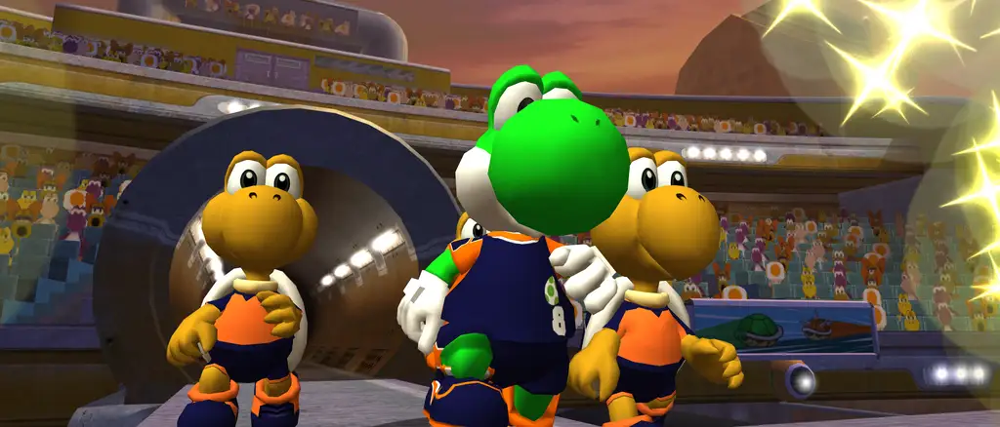

# Strikers Online - Super Mario Strikers on PC, with online play

**Download for Windows:** grab `SuperMarioStrikersOnline-windows-x86_64.zip` from the
[Releases](../../releases) page.

*Requires game data from your own copy of Super Mario Strikers. No game assets are included.*

This is a fork of [Strikers](https://github.com/new-coke/strikers), the native PC port of
Super Mario Strikers, that adds **online matches between two PCs**: create a room, send your
friend a 4-digit code, pick your teams and play. Everything else from the original port is still
here: widescreen, high frame rates, modern graphics backends, controller support, the settings app.

## What the online mode does

- **Rooms with a code.** One player creates a room, the other types its 4-digit code. A small relay
  server (included) puts the two games in touch; you can run it on your own PC.
- **Team select for two.** Each player picks a captain and sidekicks; the host picks the stadium and
  the match rules (length, teammate skill, items, Super Strikes, Bowser, cheats).
- **Both games stay identical.** The two PCs run the same 50 Hz simulation from the same inputs
  (lockstep, with an input delay picked from the ping). Every 30 frames (0.6 s) the games compare
  checksums; if they ever differ, the host's game is copied over automatically in a fraction of a
  second.
- **Goals, replays and pauses for both.** When one player scores, pauses or skips a replay, both
  games stop and start again together, with a short countdown.
- **Friendly in-game menu (F1).** Play Online, Controls (pick your controller, rebind buttons),
  Sound, Display.

## Play online

1. Download and unzip the release.
2. Open **Mario Strikers Settings** and choose your game disc image (ISO, GCM, CISO, GCZ) on the
   Game Files tab. Or put its path on the `data =` line of `strikers.ini`.
3. Put the server address the host gives you on the `server =` line of `strikers.ini`.
4. Start the game, press **F1**, open **Play Online**, type the room code and press **Join**.

The full guide, with what to do when something goes wrong: [docs/ONLINE-PLAY.md](docs/ONLINE-PLAY.md).

## Host your own server

Anyone can run the relay server: it is one small program (`strikers_relay.exe`) and a free
[Playit.gg](https://playit.gg) tunnel, so nobody has to open ports on their router. Players then put
your Playit address in their `strikers.ini`, and any of them can create rooms.

Step by step: [docs/HOSTING-A-SERVER.md](docs/HOSTING-A-SERVER.md). The relay also runs on a Linux
VPS: [server/README.md](server/README.md).

## Building from source

The game builds exactly like the original port; see its
[Development wiki page](https://github.com/new-coke/strikers/wiki/Development). The relay server is
the `strikers_relay` target of the same build. Notes for this fork: [docs/BUILDING.md](docs/BUILDING.md).

Where the online code lives:

| Path | What it is |
| --- | --- |
| `smstrikers-port/src/platform/netplay/netplay.cpp` | Session, inputs, lockstep, checksums, resync, coordinated pauses and replays |
| `smstrikers-port/src/platform/netplay/gamestate_serialize.cpp` | Saving and loading the whole match state (used to start matches and repair desyncs) |
| `smstrikers-port/src/platform/netplay/lobby.cpp` | Rooms and room codes, talking to the relay |
| `smstrikers-port/src/platform/overlay.cpp` | The F1 menu, team select and on-screen messages |
| `server/strikers_relay.cpp` | The relay server (no dependencies) |

## Credits

- The PC port: [Strikers](https://github.com/new-coke/strikers) and its author.
- The decompilation: [Yannick Suter](https://github.com/yannicksuter) and its contributors.
- [Aurora](https://github.com/encounter/aurora), which the port is built on.
- Online mode: the contributors of this fork.

## Licensing

The licensing of the original port applies unchanged; see the
[original README](https://github.com/new-coke/strikers#licensing) and the `LICENSE-*` files. In short:
the porting code is offered under CC0 1.0 where its authors hold the rights; reconstructed game code
is an unofficial reconstruction whose third-party rights are not claimed; MusyX (MIT), ODE (BSD),
Kenney's Input Prompts (CC0), Qt (LGPL 3.0) and FFmpeg's libavcodec (LGPL 2.1) keep their own
licences. The online additions in this fork are offered under the same terms as the port's own code.

No game assets are included or distributed; you must supply game data from your own copy.
This is an unofficial project, unaffiliated with and not endorsed by Nintendo or Next Level Games.
